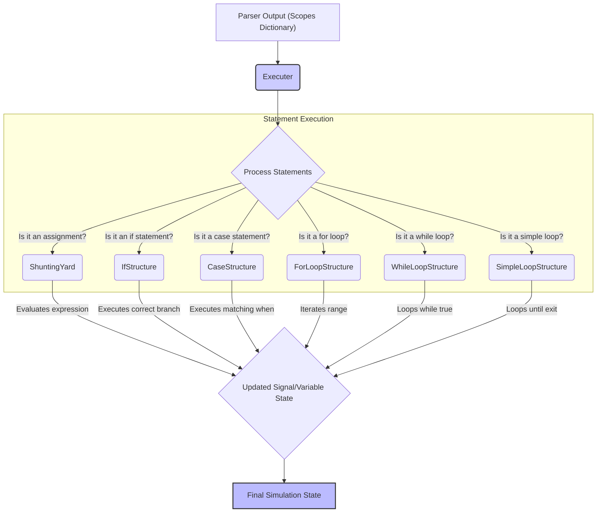
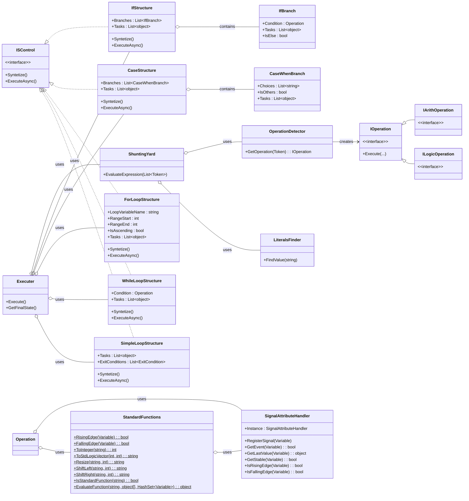
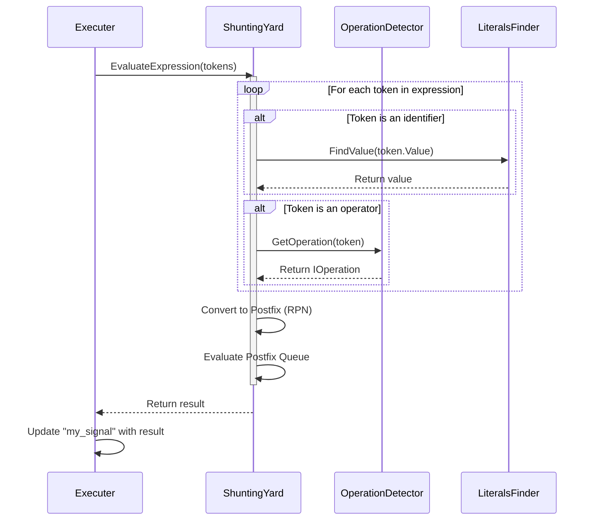
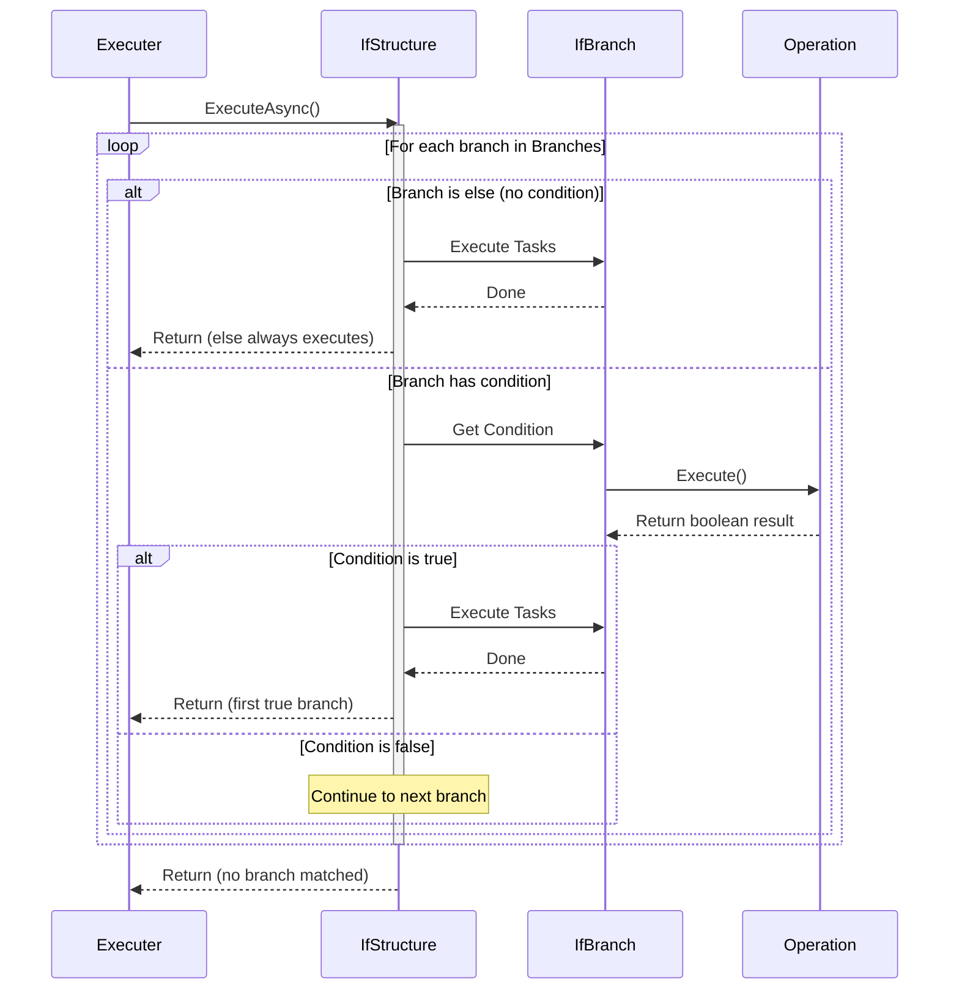
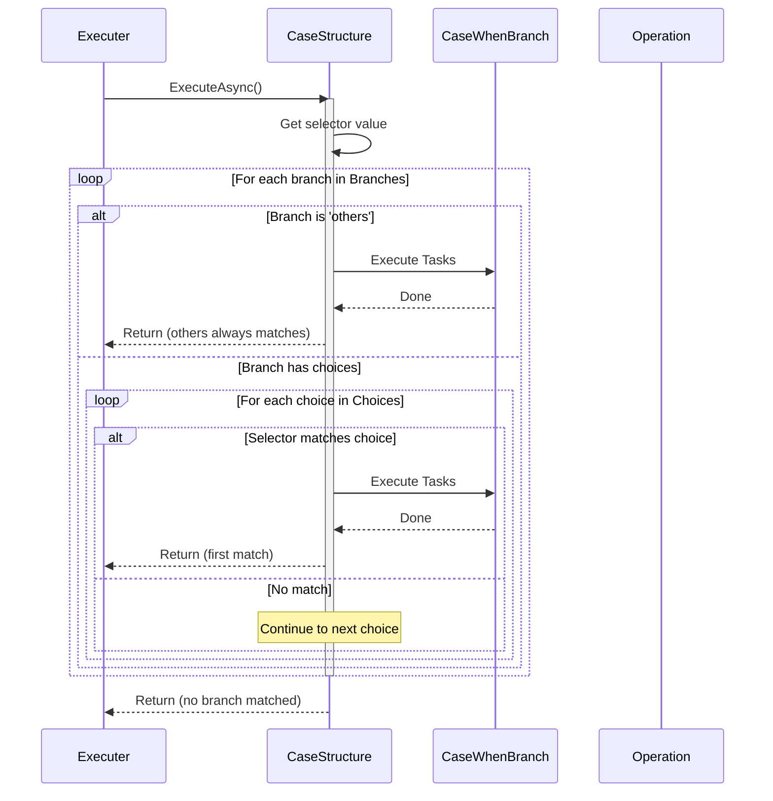
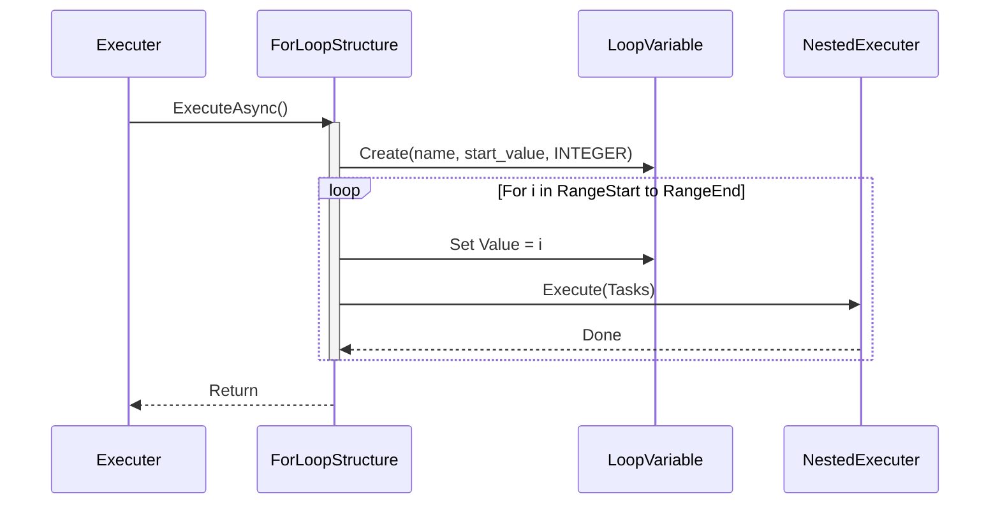
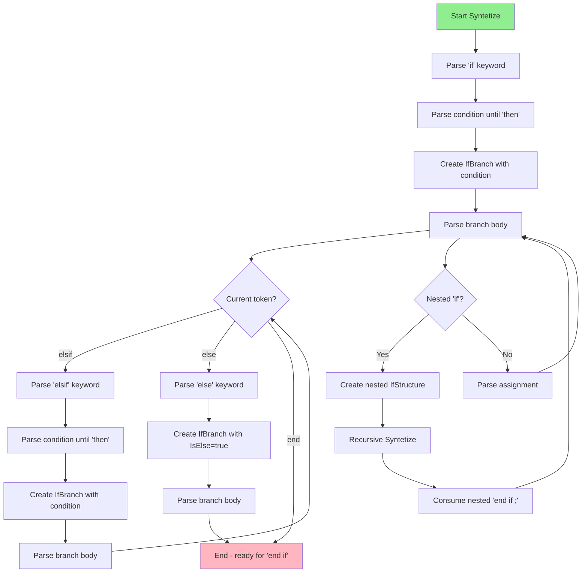
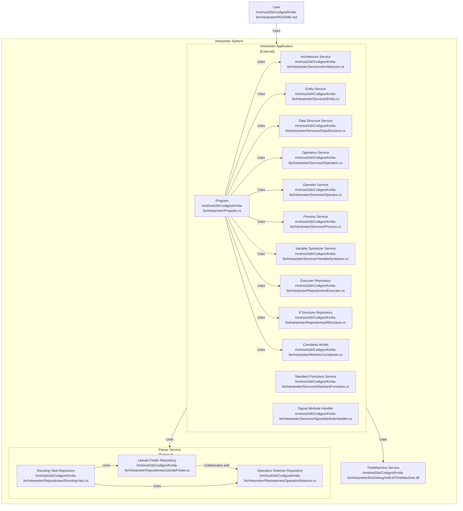

# Interpreter Module

## Project: Kmila-9s

This module is a core component of **Kmila-9s**, a project officially titled "Aplicación Multiplataforma para el Aprendizaje y Depuración de Código VHDL sin Requerimiento de Hardware Físico" (Multiplatform Application for Learning and Debugging VHDL Code without Requiring Physical Hardware).

**Author:** Ulrich Tamayo Daniel
**Email:** dulricht1700@alumno.ipn.mx
**Email 2:** danielulrichtamayo@gmail.com

---

## 1. Project Overview

The primary goal of this project is to develop a free, open-source, and multiplatform desktop application for the interactive debugging of VHDL code. The application aims to facilitate the learning of digital design by providing a unified environment for simulation and real-time visualization of digital signals, clock cycles, and port states, completely eliminating the need for physical hardware like FPGAs.

### Key Motivations
*   **Accessibility:** Overcoming the financial barrier of expensive FPGA boards and proprietary software licenses.
*   **Pedagogical Improvement:** Offering an intuitive, integrated graphical interface that simplifies the debugging process, unlike the fragmented command-line workflows of tools like GHDL and GTKWave.
*   **Flexibility:** Providing a self-contained application that runs locally on multiple operating systems (Windows, macOS, Linux, Android, iOS) without requiring an internet connection.

This project is built using .NET and MAUI, ensuring a modern and maintainable codebase with broad platform support.

## 2. The Interpreter Module

This specific module, the **VHDL Interpreter**, is the execution engine of the simulation pipeline. Its primary responsibility is to take the structured, in-memory representation of VHDL code (generated by the **Parser Module**) and simulate its behavior over time. It processes sequential statements, evaluates expressions, and updates the state of signals and variables to mimic the functionality of the described digital circuit.

### Current Status (v0.15.0)
*   **Test Pass Rate:** 80% (16 out of 20 comprehensive test files)
*   **Supported VHDL Features:** Entities, architectures, processes, signals, variables, ports, generics, if/elsif/else, case/when, for/while/simple loops, functions, procedures, IEEE standard functions
*   **Recent Improvements:** Critical regex fixes, component instantiation support, nested control structures, complex port expressions

### Core Responsibilities
*   **Expression Evaluation:** Calculating the results of arithmetic, logical, and relational operations using the Shunting-yard algorithm with proper operator precedence handling.
*   **Statement Execution:** Processing sequential statements like signal assignments, variable assignments, and control structures within VHDL processes.
*   **Control Flow Management:** Implementing the logic for conditional execution (`if-then-else`, `case-when`), loops (`for`, `while`, `loop`), and nested control structures.
*   **State Simulation:** Managing the state of all declared signals, variables, and ports, and updating their values as the simulation progresses.
*   **Event Handling:** Simulating how changes in signals trigger the execution of different processes, forming the basis of the event-driven simulation model.
*   **Function Support:** IEEE standard functions (`rising_edge`, `falling_edge`, type conversions, vector operations) and user-defined functions/procedures.

## 3. Architecture of the Interpreter Module

The interpreter is designed with a clear separation of concerns, where different classes handle expression evaluation, control flow, and overall execution orchestration.

### Key Components

*   **`Executer.cs`**: The central orchestrator of the simulation. It iterates through processes and statements, delegating the detailed work of evaluation and execution to other specialized classes.

*   **`ShuntingYard.cs`**: An implementation of the Shunting-yard algorithm. It takes a list of tokens representing an infix expression (e.g., `A + B`) and converts it into a postfix (Reverse Polish Notation) queue, which is then efficiently evaluated.

*   **`OperationDetector.cs`**: A factory class responsible for identifying operators (`+`, `-`, `AND`, `OR`, etc.) and providing the corresponding operation object that knows how to perform the calculation.

*   **`IfStructure.cs`**: Manages the execution of conditional `if-then-elsif-else` blocks. It supports:
    *   Simple `if-then-end if` statements
    *   Multiple `elsif` branches with conditions
    *   Optional `else` branch for default execution
    *   Nested if statements within any branch
    *   **[v0.15.0]** Nested case statements within if/elsif/else branches
    *   The `IfBranch` helper class represents individual branches with their conditions and tasks

*   **`CaseStructure.cs`**: Manages the execution of VHDL `case` statements. It supports:
    *   Multiple `when` branches with choice values
    *   Multiple choices per branch using `|` separator (e.g., `when "00" | "01" =>`)
    *   `when others =>` default branch
    *   Nested control structures within branches

*   **`ForLoopStructure.cs`**: Handles VHDL `for` loop statements. It supports:
    *   Ascending ranges with `to` keyword (e.g., `for i in 0 to 7 loop`)
    *   Descending ranges with `downto` keyword (e.g., `for i in 7 downto 0 loop`)
    *   Loop variable scope management
    *   Nested control structures within loop body

*   **`WhileLoopStructure.cs`**: Handles VHDL `while` loop statements. It supports:
    *   Condition evaluation before each iteration
    *   Maximum iteration safety limit (10,000 iterations)
    *   Nested control structures within loop body

*   **`SimpleLoopStructure.cs`**: Handles VHDL infinite loop statements. It supports:
    *   Basic `loop ... end loop;` syntax
    *   `exit;` statements for unconditional exit
    *   `exit when condition;` statements for conditional exit
    *   Maximum iteration safety limit

*   **`LiteralsFinder.cs`**: A utility class that resolves the values of literals and identifiers (signals, variables) by looking them up in the current scope.

*   **`StandardFunctions.cs`**: Implements IEEE standard VHDL functions from the standard libraries:
    *   `rising_edge(signal)` - Returns true when signal transitions from '0' to '1'
    *   `falling_edge(signal)` - Returns true when signal transitions from '1' to '0'
    *   `to_integer()`, `to_unsigned()`, `to_signed()` - Type conversion functions
    *   `resize()`, `shift_left()`, `shift_right()` - Vector manipulation functions
    *   `AddVectors()`, `SubtractVectors()` - Vector arithmetic operations

*   **`SignalAttributeHandler.cs`**: Handles VHDL signal attributes for edge detection and state tracking:
    *   `signal'event` - Returns true when signal value changed
    *   `signal'last_value` - Returns the previous value of a signal
    *   `signal'stable` - Returns true if signal has been stable
    *   `signal'active` - Returns true if signal had a transaction
    *   Extension methods for Variable class (`RisingEdge()`, `FallingEdge()`)

### Core Interfaces & Models

*   **`IOperation.cs`**, **`IArithOperation.cs`**, **`ILogicOperation.cs`**: A set of interfaces defining the contract for all executable operations. Each operator (like addition or conjunction) has a class that implements one of these interfaces, containing the logic to compute the result.

*   **`IControl.cs`**, **`ISControl.cs`**: Interfaces for control flow structures, ensuring that classes like `IfStructure` can be managed by the main `Executer`.

*   **`Models/Constants.cs`**: A static class that holds shared constants used throughout the interpreter, such as operator symbols and precedence levels.

## 4. Critical Design Decisions

### 4.1. Regex Pattern Anchoring (v0.15.0)

One of the most critical fixes in v0.15.0 was properly anchoring operator regex patterns. Unanchored patterns caused severe token misclassification:

**Problem Example:**
```csharp
// WRONG - Unanchored pattern
LOGIC_OPERATORS = "(and|or|xor|nand|nor|not)"

// This matches "or" in "memory" -> "mem[or]y"
// This matches "or" in "std_logic_vector" -> "std_logic_vect[or]"
// Result: Identifiers incorrectly classified as operators
```

**Solution:**
```csharp
// CORRECT - Anchored pattern
LOGIC_OPERATORS = @"^(and|or|xor|nand|nor|not|xnor|abs)$"

// Now only exact matches work
// "or" matches, but "memory" and "std_logic_vector" don't
```

This fix resolved cascading errors throughout expression parsing, improving test pass rate from 35% to 80%.

### 4.2. Expression Evaluation Strategy

The interpreter uses a two-phase approach for expression evaluation:

1. **Synthesis Phase**: Convert infix notation to postfix using Shunting-yard algorithm
2. **Execution Phase**: Evaluate postfix expression using stack-based approach

This design choice provides:
- Correct operator precedence handling
- Support for parenthesized sub-expressions
- Clear separation between parsing and evaluation

### 4.3. Port/Generic Declaration Handling

Port and generic declarations may contain complex expressions using other generics or functions:

```vhdl
generic (
    NUM_INPUTS : integer := 8;
    DATA_WIDTH : integer := 16
);
port (
    inputs : in std_logic_vector((NUM_INPUTS * DATA_WIDTH) - 1 downto 0);
    sum : out std_logic_vector(DATA_WIDTH + clog2(NUM_INPUTS) - 1 downto 0)
);
```

The interpreter skips evaluation of these expressions during declaration (v0.15.0), as:
- Functions like `clog2()` may be defined later in the architecture
- Generics are not yet assigned values during entity parsing
- Type information is sufficient for syntax validation

## 5. How to Use This Module

To use the interpreter, you first need a parsed representation of the VHDL code from the **Parser Module**. This data structure (typically a dictionary of scopes) is passed to the `Executer`, which then runs the simulation.

```csharp
using Interpreter.Repositories;
using System;
using System.Collections.Generic;

try
{
    // Assume 'parsedScopes' is the output from the VHDL Parser Module
    // var parsedScopes = vhdlParser.GetScopes();

    // 1. Initialize the main Executer with the parsed data.
    Executer vhdlExecuter = new(parsedScopes);

    // 2. Run the simulation.
    // This method would kick off the event loop and process execution.
    vhdlExecuter.Execute();

    Console.WriteLine("Simulation completed successfully!");

    // 3. After execution, you can inspect the final state of signals.
    // (Note: The actual API for retrieving results may vary)
    var finalState = vhdlExecuter.GetFinalState();
    foreach (var variable in finalState)
    {
        Console.WriteLine($"  - Signal: {variable.Name}, Final Value: {variable.Value}");
    }
}
catch (Exception ex)
{
    Console.WriteLine($"An error occurred during simulation: {ex.Message}");
}
```

## 6. Dependencies

This module is self-contained and does not have any external library dependencies beyond the standard .NET runtime. It is designed to work directly with the data structures produced by the **Parser Module**.

### Required Modules
- **Parser Module** (`/mnt/ssd1tb/Codigos/Kmila-9s/Parser/`) - Provides tokenization, entity/architecture models, and constants
- **.NET 9.0** - Target framework with C# 13 language features

### Optional Dependencies
- **TimeMachine.dll** - For time-based simulation and clock cycle management (referenced in module diagram)

## 7. Interpreter Flow and Class Relationships

To better understand the interpreter's internal workings, the following diagrams illustrate the data flow and class relationships.

### 7.1. High-Level Interpretation Flow

This diagram shows the overall process, starting from the parsed AST and ending with the final simulation state.



### 7.2. Detailed Class Diagram

This diagram details the key classes and interfaces, showing how they collaborate to execute VHDL code.



### 7.3. Sequence Diagram: Executing an Assignment

This diagram shows the runtime interactions when the `Executer` processes a signal assignment statement like `my_signal <= input_a and input_b;`.



### 7.4. Sequence Diagram: Executing an If-Elsif-Else Structure

This diagram shows how the `IfStructure` evaluates conditional branches and executes the appropriate one.



### 7.5. Sequence Diagram: Executing a Case Statement

This diagram shows how the `CaseStructure` evaluates the selector and executes the matching branch.



### 7.6. Sequence Diagram: Executing a For Loop

This diagram shows how the `ForLoopStructure` iterates through the range and executes the loop body.



### 7.7. IfStructure Synthesis Flow

This diagram shows how the `IfStructure.Syntetize()` method parses a complete if-elsif-else block from the token stream.



---
### 7.8. Module Diagram


---

## 8. Testing and Quality Assurance

### Test Suite

The interpreter includes a comprehensive test suite of 20 VHDL files covering various language features:

- **test1-test7**: Basic entities, signals, processes, and simple control structures
- **test8-test10**: Complex control flow with nested case statements
- **test11**: Generate statements with component instantiation
- **test12-test15**: Functions, procedures, and signal attributes
- **test16**: Port expressions with generic parameters
- **test17-test20**: Advanced features (components, buses, GPIO)

### Running Tests

```bash
cd /mnt/ssd1tb/Codigos/Kmila-9s/Interpreter
dotnet run --framework net9.0
```

The test runner automatically discovers all `test*.vhdl` files in the current directory and reports:
- Total entities parsed per file
- Number of ports, generics, and architecture tasks
- Pass/fail status with detailed error messages
- Final summary: X passed, Y failed, Z total

### Current Test Results (v0.15.0)

```
Test Results: 16 passed, 4 failed, 20 total
Pass Rate: 80%
```

### Debug Mode

To enable detailed debug output during development:

```bash
# Build in Debug configuration
dotnet build -c Debug
dotnet run -c Debug --framework net9.0
```

Debug output includes:
- Token stream positions during parsing
- Function/procedure skipping details
- Entity synthesis token lists
- Variable syntetizer state transitions

---

## 9. Changelog

### v0.15.0 - Regex Fixes, Parser Improvements & Component Handling (2025-12-03)

#### Bug Fixes

*   **Fixed operator regex patterns (`Constants.cs`)**:
    *   `ASSIGNATION_OPERATORS`: Changed from `@"^[(\<\=)|\:\=]"` to `@"^((\<\=)|\:\=)$"` - The bracket `[` was creating a character class that included `(`, causing parentheses to be misclassified as assignment operators
    *   `COMPARATION_OPERATORS`: Changed from `@"^[=|<|>|!=]"` to `@"^(=|!=|/=|<|>|<=|>=)$"` - Fixed similar issue and added proper operators
    *   `LOGIC_OPERATORS`: Changed from `"(and|or|xor|nand|nor|not)"` to `@"^(and|or|xor|nand|nor|not|xnor|abs)$"` - Added anchors to prevent partial matches (e.g., "std_logic_vector" matching "or")
    *   `ARITH_OPERATORS`: Changed from `@"(\+|\-|\*\*|\*|\/|mod)"` to `@"^(\+|\-|\*\*|\*|\/|mod)$"` - Added anchors

*   **Fixed unary NOT operator detection (`Operation.cs`)**: Added proper type check to ensure `**` (power) operator with `PrecedencesArithOperators.UNARY` is not treated as `PrecedencesLogicOperators.NOT`

*   **Fixed ShuntingYard precedence casting (`ShuntingYard.cs:47`)**: Changed from direct cast `(int)operation.Precedence` to `Convert.ToInt32()` to handle enum-to-int conversion when Precedence is stored as `object`

*   **Added labeled process detection (`Architecture.cs`)**: Added support for `label : process(...)` syntax where the label comes before the process keyword

*   **Fixed variable scope check (`VariableSyntetizer.cs`)**: Removed erroneous check that prevented local variable declarations in processes

*   **Added keyword handling in expressions (`Operation.cs`)**: Added explicit handling to skip `downto`, `to`, `when`, and `else` keywords during expression synthesis

*   **Fixed function/procedure parsing (`Program.cs`)**: Added `funcProcDepth` tracking to prevent `end FunctionName;` from being mistaken for architecture end

*   **Improved ToInteger safety (`StandardFunctions.cs`)**: Added checks for empty, 'U', 'X', 'Z' values and proper error handling

#### New Features

*   **Case statement support in If branches (`IfStructure.cs`)**: Added case handling in `SyntetizeBranchBody()` - case statements can now be nested inside if/elsif/else branches

*   **Component instantiation skipping (`Architecture.cs`)**: Added `SkipComponentInstantiation()` method to handle `label : ComponentName [generic map (...)] port map (...);` syntax

*   **Port/Generic expression skipping (`VariableSyntetizer.cs`)**: Added special handling for ports and generics with complex expressions (e.g., `(NUM_INPUTS * DATA_WIDTH) - 1`) - skips evaluation and uses default size to prevent errors from undefined functions like `clog2()`

#### Test Results Summary

*   **Passing Tests**: 16/20 (up from 7/20)
    *   Newly passing: test8, test9, test10, test12, test13, test14, test15, test16, test19
*   **Remaining Failures**: 4/20 (test11, test17, test18, test20)
    *   test11, test17, test20: Entity name token positioning issue
    *   test18: Bus keyword handling issue

#### Technical Improvements

*   Added comprehensive debug logging in Entity and VariableSyntetizer classes
*   Improved token stream consumption in entity/port parsing
*   Better parenthesis depth tracking for complex port expressions

---

### v0.14.0 - IEEE Standard Functions & Expression Handling (2025-11-27)

#### New Features

*   **IEEE Standard Functions (`StandardFunctions.cs`)**:
    *   `rising_edge(signal)` - Returns true if signal has an event and current value is '1'
    *   `falling_edge(signal)` - Returns true if signal has an event and current value is '0'
    *   `to_integer(slv)` / `conv_integer(slv)` - Converts std_logic_vector to integer
    *   `to_unsigned(val, width)` / `unsigned(val, width)` - Converts integer to unsigned vector
    *   `to_signed(val, width)` / `signed(val, width)` - Converts integer to signed vector
    *   `resize(value, newWidth)` - Resizes a vector to new width
    *   `shift_left(value, amount)` / `shift_right(value, amount)` - Logical shifts
    *   Vector arithmetic helpers: `AddVectors()`, `SubtractVectors()`

*   **Standard Function Detection (`Operation.cs`)**:
    *   `TryParseStandardFunction()` - Parses function calls as single tokens like `rising_edge(clk)`
    *   `ParseFunctionCall()` - Parses function calls with separate tokens
    *   Integrated with expression synthesis for seamless function support in conditions

#### Bug Fixes

*   **Fixed `_rawData` assignment bug (`Operation.cs:60`)**: The line `RawData = _rawData` was inverted, causing RawData to be lost. Fixed to `_rawData = RawData`.

*   **Added condition expression support (`Operation.cs`)**: Expressions without `<=` assignment operator (i.e., conditions like `rising_edge(clk)`) now create a temporary Result variable with `PortType.OUT` instead of throwing "Input ports are not eligible for assignations" error.

*   **Case-insensitive variable matching (`Operation.cs:65`)**: Changed variable lookup to use `StringComparison.OrdinalIgnoreCase` for VHDL's case-insensitive identifiers.

*   **Fixed CaseStructure `=>` tokenization (`CaseStructure.cs`)**: The case statement parser was looking for `=` to detect the arrow operator, but `=>` is tokenized as a single token by the Parser. Changed to look for `=>` directly, fixing test3 hang issue.

*   **Added safety iteration limits in CaseStructure**: Added maximum iteration checks to all parsing loops to prevent infinite loops from malformed input.

#### Test Results Summary

*   **Passing Tests**: 3/20 (test1.vhdl, test2.vhdl, test3.vhdl)
*   **Parser-Level Failures**: 8 tests require Parser changes for custom types, aggregates, time literals
*   **Interpreter-Level Failures**: 9 tests need additional features like `(others => '0')`, component instantiation

#### Known Limitations

The following VHDL features require Parser-level changes and cannot be supported in the Interpreter alone:

*   Record types and custom type definitions (`filter_config_t`, `axi_lite_m2s_t`)
*   VHDL aggregates `(others => '0')`
*   Array slicing with complex expressions `signal(expr1 downto expr2)`
*   Type conversion functions `unsigned()`, `signed()`, `resize()`
*   Time literals (`ns`, `ps`, `us`, etc.)
*   Range type constraints
*   Generate statements (`for-generate`, `if-generate`)

---

### v0.13.0 - Control Structures & Signal Attributes (2025-11-27)

#### New Features

*   **Case/When Statement Support (`CaseStructure.cs`)**:
    *   Full support for VHDL `case selector is when choice => statements; end case;` syntax
    *   Multiple choices per branch using `|` separator
    *   `when others =>` default branch handling
    *   Nested control structures within case branches

*   **For Loop Support (`ForLoopStructure.cs`)**:
    *   Ascending loops with `to` keyword: `for i in 0 to 7 loop`
    *   Descending loops with `downto` keyword: `for i in 7 downto 0 loop`
    *   Automatic loop variable creation and scope management
    *   Support for nested control structures in loop body

*   **While Loop Support (`WhileLoopStructure.cs`)**:
    *   Condition evaluation before each iteration
    *   Maximum iteration safety (10,000 iterations) to prevent infinite loops
    *   Full support for nested structures

*   **Simple Loop Support (`SimpleLoopStructure.cs`)**:
    *   Basic `loop ... end loop;` infinite loop syntax
    *   `exit;` unconditional exit statement
    *   `exit when condition;` conditional exit statement
    *   Exit condition tracking and evaluation

*   **Signal Attributes (`SignalAttributeHandler.cs`)**:
    *   `signal'event` - Detects when a signal value has changed
    *   `signal'last_value` - Returns the previous value of a signal
    *   `signal'stable` - Returns true if signal has not changed
    *   `signal'active` - Returns true if signal had a transaction
    *   Extension methods: `RisingEdge()`, `FallingEdge()`
    *   Singleton pattern for global signal state tracking

*   **Process Body Parsing (`Process.cs`)**:
    *   Full implementation of `SyntetizeBehaviour()` method
    *   Support for if, case, for, while, and simple loop statements within processes
    *   Proper `end process;` token consumption

#### Bug Fixes

*   **Fixed less-than operator (`Operator.cs:225`)**: The `<` operator was incorrectly using `==` comparison instead of `<`.

*   **Added missing comparison operators**: Added support for `>=`, `<=`, and `/=` (not equal) operators.

*   **STD_LOGIC_VECTOR comparison**: Added support for vector equality (`=`) and inequality (`!=`, `/=`) comparisons.

#### Test Cases

*   Added 3 new test files (test6-test8.vhdl) covering:
    *   Case/When statements with multiple branches
    *   Process blocks with control structures
    *   Combined if and case structures

*   All 8 test cases pass successfully.

---

### v0.12.0 - If Structure Implementation (2025-11-26)

#### New Features
*   **Complete `if-elsif-else` support**: The `IfStructure` class now fully supports VHDL conditional statements including:
    *   Simple `if condition then ... end if;` statements
    *   Multiple `elsif condition then ...` branches
    *   Optional `else ...` default branch
    *   Nested if statements within any branch

*   **`IfBranch` helper class**: A new class to represent individual branches of an if statement, containing:
    *   `Condition`: The operation to evaluate (null for else branches)
    *   `Tasks`: List of operations/structures to execute
    *   `IsElse`: Flag indicating if this is an else branch

#### Bug Fixes
*   **Fixed `Architecture.SyntetizeAssingations()`**: Changed termination condition from `"then"` to `";"` which was causing signal assignments to be parsed incorrectly.

*   **Fixed architecture end detection in `Program.cs`**: The parser now correctly distinguishes between `end if;`, `end process;`, etc. and `end <architecture_name>;` to properly capture all statements within an architecture block.

*   **Added `ConsumeEndIf()` method**: Properly consumes `end if ;` tokens after processing if structures to prevent token stream corruption.

#### Architecture Changes
*   `IfStructure` redesigned from recursive elsif/else chain to a flat `List<IfBranch>` structure for better maintainability and execution control.
*   Added proper handling for nested if statements with recursive synthesis and token consumption.

---
*Generated by [CodeViz.ai](https://codeviz.ai) on 11/4/2025, 7:06:51 PM*
