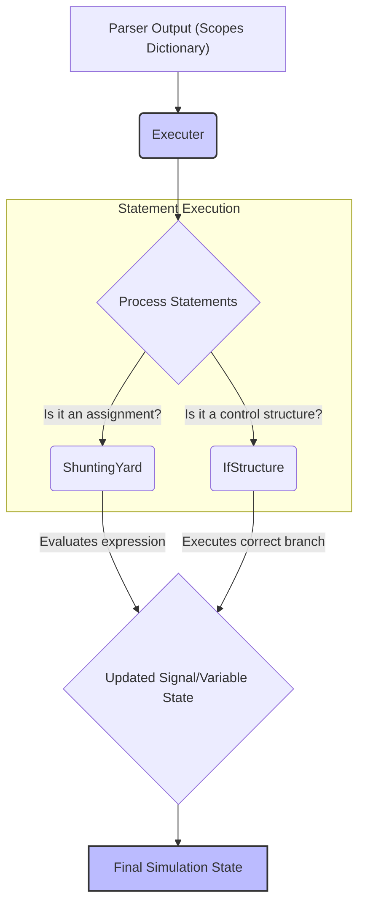
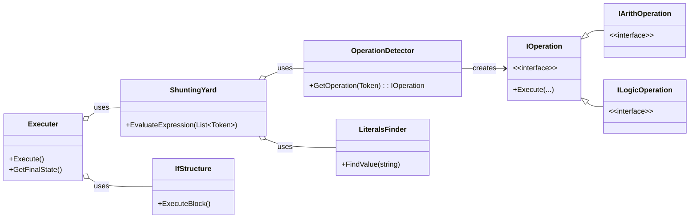
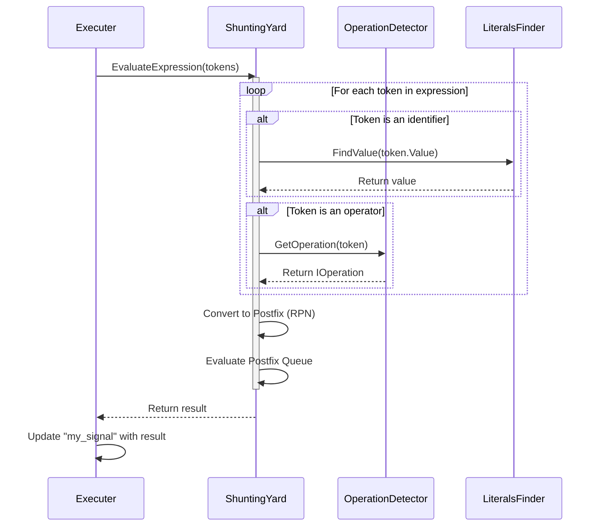
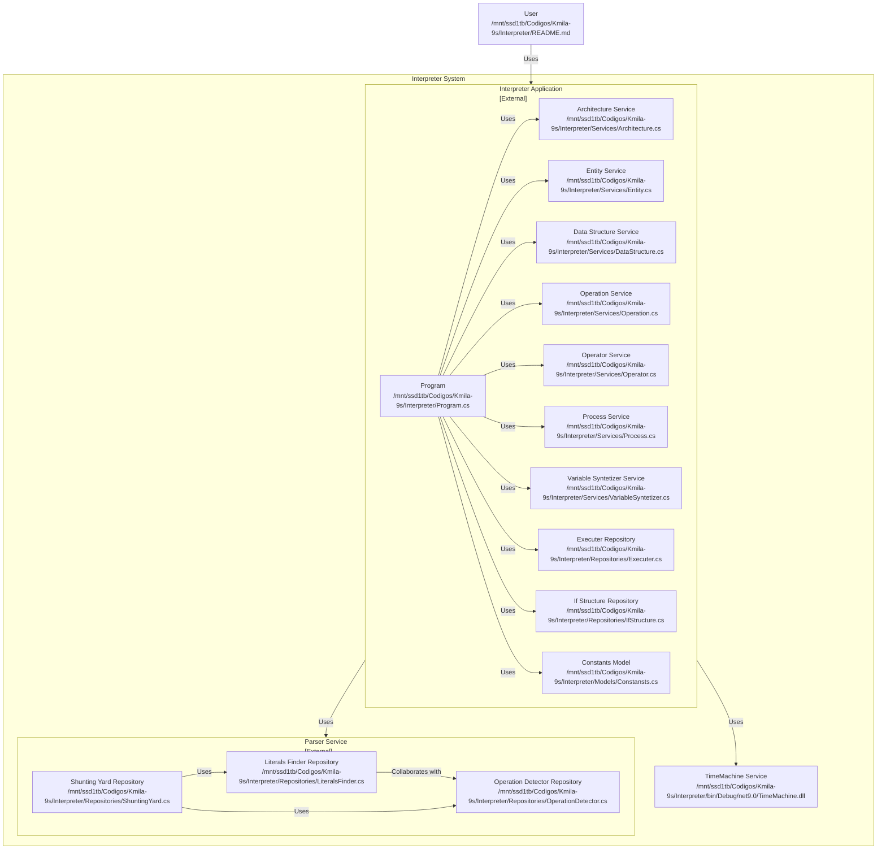

# Interpreter Module

## Project: Kmila-9s

This module is a core component of **Kmila-9s**, a project officially titled "Aplicación Multiplataforma para el Aprendizaje y Depuración de Código VHDL sin Requerimiento de Hardware Físico" (Multiplatform Application for Learning and Debugging VHDL Code without Requiring Physical Hardware).

**Author:** Ulrich Tamayo Daniel
**Email:** dulricht1700@alumno.ipn.mx
**Email 2:** danielulrichtamayo@gmail.com

---

## 1. Project Overview

The primary goal of this project is to develop a free, open-source, and multiplatform desktop application for the interactive debugging of VHDL code. The application aims to facilitate the learning of digital design by providing a unified environment for simulation and real-time visualization of digital signals, clock cycles, and port states, completely eliminating the need for physical hardware like FPGAs.

### Key Motivations
*   **Accessibility:** Overcoming the financial barrier of expensive FPGA boards and proprietary software licenses.
*   **Pedagogical Improvement:** Offering an intuitive, integrated graphical interface that simplifies the debugging process, unlike the fragmented command-line workflows of tools like GHDL and GTKWave.
*   **Flexibility:** Providing a self-contained application that runs locally on multiple operating systems (Windows, macOS, Linux, Android, iOS) without requiring an internet connection.

This project is built using .NET and MAUI, ensuring a modern and maintainable codebase with broad platform support.

## 2. The Interpreter Module

This specific module, the **VHDL Interpreter**, is the execution engine of the simulation pipeline. Its primary responsibility is to take the structured, in-memory representation of VHDL code (generated by the **Parser Module**) and simulate its behavior over time. It processes sequential statements, evaluates expressions, and updates the state of signals and variables to mimic the functionality of the described digital circuit.

### Core Responsibilities
*   **Expression Evaluation:** Calculating the results of arithmetic, logical, and relational operations using the Shunting-yard algorithm.
*   **Statement Execution:** Processing sequential statements like signal assignments, variable assignments, and control structures within VHDL processes.
*   **Control Flow Management:** Implementing the logic for conditional execution, such as `if-then-else` and `case` statements.
*   **State Simulation:** Managing the state of all declared signals, variables, and ports, and updating their values as the simulation progresses.
*   **Event Handling:** Simulating how changes in signals trigger the execution of different processes, forming the basis of the event-driven simulation model.

## 3. Architecture of the Interpreter Module

The interpreter is designed with a clear separation of concerns, where different classes handle expression evaluation, control flow, and overall execution orchestration.

### Key Components

*   **`Executer.cs`**: The central orchestrator of the simulation. It iterates through processes and statements, delegating the detailed work of evaluation and execution to other specialized classes.

*   **`ShuntingYard.cs`**: An implementation of the Shunting-yard algorithm. It takes a list of tokens representing an infix expression (e.g., `A + B`) and converts it into a postfix (Reverse Polish Notation) queue, which is then efficiently evaluated.

*   **`OperationDetector.cs`**: A factory class responsible for identifying operators (`+`, `-`, `AND`, `OR`, etc.) and providing the corresponding operation object that knows how to perform the calculation.

*   **`IfStructure.cs`**: Manages the execution of conditional `if-then-elsif-else` blocks. It evaluates the condition and ensures that only the correct branch of code is executed.

*   **`LiteralsFinder.cs`**: A utility class that resolves the values of literals and identifiers (signals, variables) by looking them up in the current scope.

### Core Interfaces & Models

*   **`IOperation.cs`**, **`IArithOperation.cs`**, **`ILogicOperation.cs`**: A set of interfaces defining the contract for all executable operations. Each operator (like addition or conjunction) has a class that implements one of these interfaces, containing the logic to compute the result.

*   **`IControl.cs`**, **`ISControl.cs`**: Interfaces for control flow structures, ensuring that classes like `IfStructure` can be managed by the main `Executer`.

*   **`Models/Constants.cs`**: A static class that holds shared constants used throughout the interpreter, such as operator symbols and precedence levels.

## 4. How to Use This Module

To use the interpreter, you first need a parsed representation of the VHDL code from the **Parser Module**. This data structure (typically a dictionary of scopes) is passed to the `Executer`, which then runs the simulation.

```csharp
using Interpreter.Repositories;
using System;
using System.Collections.Generic;

try
{
    // Assume 'parsedScopes' is the output from the VHDL Parser Module
    // var parsedScopes = vhdlParser.GetScopes();

    // 1. Initialize the main Executer with the parsed data.
    Executer vhdlExecuter = new(parsedScopes);

    // 2. Run the simulation.
    // This method would kick off the event loop and process execution.
    vhdlExecuter.Execute();

    Console.WriteLine("Simulation completed successfully!");

    // 3. After execution, you can inspect the final state of signals.
    // (Note: The actual API for retrieving results may vary)
    var finalState = vhdlExecuter.GetFinalState();
    foreach (var variable in finalState)
    {
        Console.WriteLine($"  - Signal: {variable.Name}, Final Value: {variable.Value}");
    }
}
catch (Exception ex)
{
    Console.WriteLine($"An error occurred during simulation: {ex.Message}");
}
```

## 5. Dependencies

This module is self-contained and does not have any external library dependencies beyond the standard .NET runtime. It is designed to work directly with the data structures produced by the **Parser Module**.

## 6. Interpreter Flow and Class Relationships

To better understand the interpreter's internal workings, the following diagrams illustrate the data flow and class relationships.

### 6.1. High-Level Interpretation Flow

This diagram shows the overall process, starting from the parsed AST and ending with the final simulation state.



### 6.2. Detailed Class Diagram

This diagram details the key classes and interfaces, showing how they collaborate to execute VHDL code.



### 6.3. Sequence Diagram: Executing an Assignment

This diagram shows the runtime interactions when the `Executer` processes a signal assignment statement like `my_signal <= input_a and input_b;`.


---
### 6.4. Module Diagram

---
*Generated by [CodeViz.ai](https://codeviz.ai) on 11/4/2025, 7:06:51 PM*
